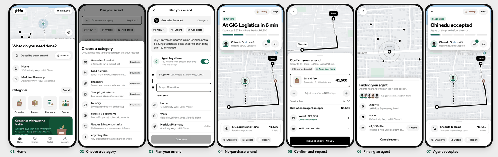
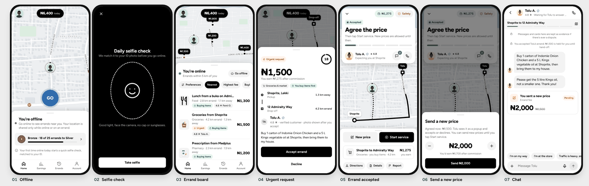

<p align="center">
  <picture>
    <source media="(prefers-color-scheme: dark)" srcset="brand/jiffo-wordmark-white.svg">
    
  </picture>
</p>

<h3 align="center">Get your errands done.</h3>

<p align="center">
  Groceries, parcels, pharmacy runs and queues, by verified agents near you in Nigeria.<br>
  Your money is held until the errand is done.
</p>

<p align="center">
  <a href="https://github.com/aitradeosdev/jiffo/actions/workflows/ci.yml"></a>
  <a href="https://github.com/aitradeosdev/jiffo/actions/workflows/security.yml"></a>
  
  
  
</p>

<p align="center">
  <a href="#getting-started">Getting started</a> ·
  <a href="#how-an-errand-works">How it works</a> ·
  <a href="#architecture">Architecture</a> ·
  <a href="docs/admin-panel.md">Admin panel</a> ·
  <a href="#security">Security</a>
</p>

---

## Overview

Jiffo is an errand marketplace for Nigeria. Customers post an errand (groceries, parcels, pharmacy runs, queues and more), a verified agent nearby accepts it, and the money is held in escrow until hand-off. The customer releases it with a PIN or by approving a drop-off photo.

The product is built from day one with adapters, so new countries, states and outside providers (payments, identity checks, maps, chat, calls, SMS, push, storage) plug in without changing the core.

<table>
  <tr>
    <td align="center" valign="top" width="33%">
      <br>
      <b>Jiffo</b><br>
      <sub>iOS and Android</sub>
      <p>For customers: post an errand, follow the agent live, chat and call without sharing numbers, and release the money with a PIN or by approving a drop-off photo.</p>
    </td>
    <td align="center" valign="top" width="33%">
      <br>
      <b>Jiffo Agent</b><br>
      <sub>iOS and Android</sub>
      <p>For agents: apply and verify once, go online, take errands from the board nearby, and withdraw earnings to a bank account in their own name.</p>
    </td>
    <td align="center" valign="top" width="33%">
      <br>
      <b>Admin panel</b><br>
      <sub>Web</sub>
      <p>For Jiffo staff: errands and disputes, people, applications and ID checks, money, settings and providers. See <a href="docs/admin-panel.md">the admin panel guide</a>.</p>
    </td>
  </tr>
</table>

## Screens

<p align="center">
  
  <br><sub><b>Jiffo</b>: from posting an errand to an agent accepting it</sub>
</p>

<p align="center">
  
  <br><sub><b>Jiffo Agent</b>: from going online to agreeing the price</sub>
</p>

Every screen of the design, numbered: [customer app](docs/prototype-sheets/jiffo-customer-prototype.png) (31 screens) and [agent app](docs/prototype-sheets/jiffo-agent-prototype.png) (45). To click through them, download [`docs/prototypes/customer.html`](docs/prototypes/customer.html) or [`agent.html`](docs/prototypes/agent.html) and open it in a browser; the panel beside the phone jumps to any screen and plays the other side of the errand.

## How an errand works

1. **Post.** The customer says what they need, picks a category and the stops, and sees a suggested fee for the distance.
2. **Match.** Verified agents nearby see it on their board, with only the general area until one accepts. When an agent accepts, the fee and service fee are held from the customer's wallet.
3. **Agree.** Before starting, the agent may ask for a new price, which the customer accepts or declines. For a purchase, the agent sends the receipt and the customer locks the item amount, held separately.
4. **Track.** The customer follows the agent on the map, and they chat and call without either seeing the other's number.
5. **Hand off.** The customer gives the agent their PIN, or, when nobody can come to the door, approves the agent's drop-off photo.
6. **Get paid.** Item money goes to the agent at once. The fee, less the commission for the agent's tier, goes to their earnings, which they withdraw to a bank account in their own name.

## Highlights

- **Money held safely.** A double-entry ledger in whole kobo, escrow from acceptance to hand-off, webhooks applied exactly once, and a nightly check against the payment provider.
- **Verified people.** Customers and agents check their ID with a selfie, through Smile ID. One account per ID.
- **Live and private.** Live location while an agent is on the way, chat with photos, and calls that hide both numbers.
- **Providers chosen in the panel.** SMS, payments, identity checks, calls, push, maps, files and email. Keys are stored encrypted and a switch takes effect without a restart.
- **Ready for more countries.** Countries, states, categories and versioned settings are data, not code.
- **Staff controls.** Roles, passkeys, two-person approval, masked personal details and an audit log nobody can rewrite.

## Tech stack

| Layer       | Built with                                                                            |
| ----------- | ------------------------------------------------------------------------------------- |
| Apps        | React Native with Expo (TypeScript). One codebase, two store apps                     |
| Admin panel | Next.js (TypeScript)                                                                  |
| Backend     | Node.js with NestJS, one deployable app split into modules                            |
| Data        | PostgreSQL with PostGIS; Redis with BullMQ for live locations, rate limits and timers |
| Real-time   | WebSockets (Socket.IO over Redis) and Firebase Cloud Messaging                        |
| Files       | S3 private storage with signed links                                                  |
| Hosting     | AWS Cape Town (af-south-1), pending legal confirmation for data residency             |

## Repository layout

| Path                     | Contents                                                                                                                                                                                                                          |
| ------------------------ | --------------------------------------------------------------------------------------------------------------------------------------------------------------------------------------------------------------------------------- |
| `apps/mobile/`           | The Customer and Agent apps (Expo, React Native). One codebase builds both store apps; see below.                                                                                                                                 |
| `apps/admin/`            | The admin panel (Next.js) for Jiffo staff. See below.                                                                                                                                                                             |
| `apps/api/`              | The backend (NestJS). Accounts and phone sign-in, country settings, the errand lifecycle, chat, push and the realtime socket. See below.                                                                                          |
| `packages/shared/`       | Code the backend and the apps share: the errand state machine, money in kobo, the country settings schema and ID types.                                                                                                           |
| `docs/prototypes/`       | Clickable HTML prototypes of the customer app (`customer.html`) and the agent app (`agent.html`). Open either file in a browser. The panel beside the phone jumps to every screen and lets you play the other side of the errand. |
| `docs/prototypes/src/`   | The prototype source files and build scripts. Run `sh build.sh` and `sh build-agent.sh` from this folder to rebuild the two HTML files.                                                                                           |
| `docs/prototype-sheets/` | One overview image per app, showing every prototype screen, numbered and labelled.                                                                                                                                                |
| `brand/`                 | The Jiffo logo set: wordmark, app icons and the small j mark as SVG, plus PNG exports. See `brand/README.md`.                                                                                                                     |
| `docs/`                  | The [admin panel guide](docs/admin-panel.md), the [security plan](docs/security-plan.md), [audit](docs/security-audit.md) and [controls](docs/security/controls.md), and the [route list](docs/api/openapi.json).                 |

## Getting started

### Prerequisites

Node 22, pnpm 10 and Docker.

### Backend

```bash
pnpm install
docker compose up -d
cp apps/api/.env.example apps/api/.env
```

Fill in `JWT_SECRET`, `OTP_SECRET` and `PIN_KEY` in `apps/api/.env` (`openssl rand -hex 32` for each), then:

```bash
pnpm build
cd apps/api && set -a && . ./.env && set +a && pnpm start
```

The API listens on port 3000. `RUN_MIGRATIONS=true` applies the database migrations at start-up, including the Nigeria seed: 37 states, 8 categories and the first settings version. Errands are taken only inside areas drawn in the admin panel (Places). To try the apps before drawing any, add one area covering all of Lagos, for development only:

```bash
cd apps/api && pnpm build && set -a && . ./.env && set +a && pnpm admin dev-areas
```

With the console providers, sign-in codes and push notifications are printed to the log instead of being sent. To see the codes in the app instead, switch the country's sign-in codes to Test (admin panel, Settings, Security): the code screen then shows each one.

Tests run against real Postgres and Redis. Each run creates a throwaway database and drops it at the end:

```bash
pnpm test
```

Before opening a pull request, also run `pnpm lint`, `pnpm format:check` and `pnpm typecheck`. CI runs the same checks.

After changing `apps/api/src/db/schema.ts`, run `pnpm --filter @jiffo/api db:generate` and commit the new migration.

### Mobile apps

`apps/mobile` builds both store apps from one codebase. `APP_VARIANT` picks which one: `customer` (Jiffo, the default) or `agent` (Jiffo Agent). Each has its own name, icon, bundle identifier and screens.

With the backend running locally:

```bash
cd apps/mobile
EXPO_PUBLIC_API_URL=http://<your computer's LAN address>:3000 pnpm start
```

Open it in Expo Go, or press `w` for the web version. Withdrawals and bank changes in the agent app are signed by a key in the phone's secure hardware (`modules/device-key`, Jiffo's own native module), which Expo Go and the web can't run: try them in a development build installed on a phone: [docs/mobile-builds.md](docs/mobile-builds.md) has the steps for Android and iPhone, and for checking a release build. The web version draws a stand-in map; phones draw Google's map. Builds need `GOOGLE_MAPS_ANDROID_API_KEY` (Maps SDK for Android) and `GOOGLE_MAPS_IOS_API_KEY` (Maps SDK for iOS); without them, Android's map is blank and the iPhone draws Apple's map instead, and store builds stop (docs/mobile-builds.md). Use `pnpm start:agent` for the agent app. Switching between the two needs the bundler cache cleared, which both scripts do.

A new customer checks their ID right after giving their name: their NIN or BVN and a selfie, once, with the identity provider in use; they can look around first, and adding money and requesting errands open once they are verified. A new agent fills in the application before seeing the board: their state and area, identity (one of the IDs admin accepts for agents, their BVN when required, and a selfie), address and an emergency contact, a payout account, errand preferences, and the agent terms. In development the identity provider is a stand-in: an ID number ending in 1111 sends the selfie to review, 1818 is someone under 18, 0000 fails the ID, and any other passes. With `FAKE_PAYMENTS_AUTOPAY_SECONDS` set, the fake bank also takes any account number to be in the agent's name.

While an agent is online or on an errand, the agent app keeps sending their location when they switch to their maps app or lock the phone, if they chose "Allow all the time" (the app explains why before the phone asks). On Android a notification shows while it does. It stops when they go offline with nothing running. This needs a development or store build; Expo Go and the web version send the location only while the app is open.

`pnpm --filter @jiffo/mobile export:web` builds both apps for the web, the same way CI does.

### Admin panel

`apps/admin` is the panel Jiffo staff use. Its server calls the API on each admin's behalf, so the session token stays in an httpOnly cookie and never reaches the browser's scripts.

```bash
cd apps/admin
cp .env.example .env.local
pnpm dev
```

It opens on port 3001. Set `ADMIN_PANEL_SECRET` to the same value in both `apps/api/.env` and `apps/admin/.env.local`, so the API sees each admin's own IP address for sign-in limits and the audit log.

Admins join by invite only. Make the first owner from the API's folder, with the API's environment loaded:

```bash
pnpm admin invite --email you@jiffoapp.com --name "Your Name" --role owner --phone "0803 123 4567" --reason "First owner"
```

Open the printed link to choose a password. The first sign-in sets up an authenticator app (Google Authenticator, Microsoft Authenticator, 1Password), and every sign-in after that needs its code.

The phone number is the owner's own: it links the Jiffo app account they hold, which they then can't change from the panel.

In production the panel must sit behind a load balancer (`TRUST_PROXY_HOPS` of at least 1), and the API needs `ADMIN_URL` set to the panel's address for invite links. The API also needs `ADMIN_API_PORT`: admin routes answer only on that port and the apps' routes only on the public one, so the admin port can sit behind the team's access control (single sign-on, such as Cloudflare Access or Google IAP) and off the open internet. Point the panel's `API_URL` at it.

Roles, passkeys, sessions, two-person approval, the audit log and personal details are covered in [docs/admin-panel.md](docs/admin-panel.md).

## Architecture

### API outline

All routes are under `/v1` except `GET /health`. The full list, with who may call each route and what it takes, is [docs/api/openapi.json](docs/api/openapi.json). Errors always look like `{ "error": { "code": "...", "message": "..." } }`.

| Area              | Routes                                                                                                                                                                                                                                                                                                                                                                                                                                                                 |
| ----------------- | ---------------------------------------------------------------------------------------------------------------------------------------------------------------------------------------------------------------------------------------------------------------------------------------------------------------------------------------------------------------------------------------------------------------------------------------------------------------------- |
| Sign-in           | `POST /auth/otp/request`, `POST /auth/otp/verify`, `POST /auth/refresh`, `POST /auth/logout`, `POST /auth/logout-others`                                                                                                                                                                                                                                                                                                                                               |
| Profile           | `GET /me`, `PATCH /me`, `PUT /devices/current/push-token`                                                                                                                                                                                                                                                                                                                                                                                                              |
| Agent profile     | `GET /agent/profile`, `PATCH /agent/profile`: categories and purchase errands the agent takes; the tier is set by admin                                                                                                                                                                                                                                                                                                                                                |
| Calls             | `POST /errands/:id/call` (rings the caller's phone, then connects them to the other side of the errand)                                                                                                                                                                                                                                                                                                                                                                |
| Agent presence    | `GET /agent/presence`, `PUT /agent/presence` (`online` and the position; the position alone, from the background, keeps online as it was)                                                                                                                                                                                                                                                                                                                              |
| Agent application | `GET /agent/application`, `PATCH /agent/application` (state and area), `POST /agent/application/identity` and `/identity/finish` (the chosen ID, the BVN when required, and a selfie, through the identity provider or its own page, whose result arrives at `POST /webhooks/identity/:provider`), `PUT /agent/application/address`, `POST /agent/application/terms`, `POST /agent/application/submit`. Agents see the board, go online and accept only once approved. |
| Customer identity | `GET /me/identity` (status, and the IDs the customer can use), `POST /me/identity` (start with the chosen ID), `POST /me/identity/finish`. Top-ups and errand requests need a verified customer.                                                                                                                                                                                                                                                                       |
| Country config    | `GET /config/:country`: currency, states, categories and the public settings                                                                                                                                                                                                                                                                                                                                                                                           |
| Photos            | `POST /uploads`: a signed link to upload a receipt, item, drop-off or chat photo for an errand. Events and messages accept only photos their sender uploaded for that errand.                                                                                                                                                                                                                                                                                          |
| Ratings           | `POST /errands/:id/rating`: once each way after completion                                                                                                                                                                                                                                                                                                                                                                                                             |
| Places            | `GET /places/autocomplete`, `GET /places/:id` (with the state it is in)                                                                                                                                                                                                                                                                                                                                                                                                |
| Errands           | `POST /errands/quote` (distance and suggested fee), `POST /errands`, `GET /errands`, `GET /errands/board` (agent app), `GET /errands/:id`, `GET /errands/:id/events`, `GET /errands/:id/pin` (customer, once delivered), `POST /errands/:id/events`                                                                                                                                                                                                                    |
| Chat              | `GET /errands/:id/messages`, `POST /errands/:id/messages` (text or a photo)                                                                                                                                                                                                                                                                                                                                                                                            |
| Wallet            | `GET /wallet`, `GET /wallet/transactions`, `GET /wallet/top-up` (the ways to add money on offer, and the customer's own account number), `POST /wallet/fixed-account`, `POST /wallet/deposits` and `GET /wallet/deposits/:id` (customer app), `GET /banks`, `POST /wallet/withdrawals` (agent app), `POST /errands/:id/tip`                                                                                                                                            |
| Payouts           | `GET /banks`, `GET /payout-account`, `PUT /payout-account` (agent app)                                                                                                                                                                                                                                                                                                                                                                                                 |
| Webhooks          | `POST /webhooks/paystack`: signature-checked, stored, applied once                                                                                                                                                                                                                                                                                                                                                                                                     |
| Realtime          | Socket.IO namespace `/realtime`, with the access token in `auth.token`. Emit `errand.subscribe`; receive `errand.updated` and `message.created`.                                                                                                                                                                                                                                                                                                                       |
| Admin             | Under `/admin`, for the admin panel only: sign-in (`auth/sign-in`, `auth/setup`, `auth/code`, `auth/sign-out`, invites), `me`, `overview`, `team`, `audit`, `errands` (search and full history), `disputes` and `errands/:id/actions` (step in, redelivery, settle). Admin sessions are separate from app sessions.                                                                                                                                                    |

Every errand change goes through one endpoint, `POST /errands/:id/events`, with an event name such as `accept`, `send_offer`, `start`, `send_item_amount`, `mark_delivered` or `confirm_pin`. Who is acting comes from the session (customer app or agent app), never from the request. Each errand view lists the `allowedEvents` for the caller, so the apps show only the actions that are possible.

### Adapters and providers

Each outside service is a port with one adapter per provider. **Owners choose the provider in the admin panel** (Settings, Providers): they enter the keys from Jiffo's account with it, test them, and switch it on. The change reaches every API process within 30 seconds, with no restart. Keys are stored encrypted (AES-256-GCM) under `SECRETS_KEY`, a 64-character hex key that production requires and that should be kept apart from the database: whoever has both can read the keys, and changing it means entering them again. The panel never shows a saved key, only its last characters, and the audit log records which fields changed, never their values. A provider can be switched on only after its test passes. Things a provider started finish with it after a switch: a top-up is checked with the provider that issued its account number, an identity check finishes where it began, and a payout goes through the provider in use, which registers the agent's bank account first if it was added under another one. The nightly money check adds up every provider still holding money.

Webhook addresses are shown in the panel, built from `PUBLIC_API_URL`, which must be the API's public https address in production (it won't start otherwise).

| Service         | Providers in the panel         |
| --------------- | ------------------------------ |
| SMS codes       | Termii, Africa's Talking       |
| Payments        | Paystack, Flutterwave          |
| Identity checks | Smile ID                       |
| Calls           | Africa's Talking, Twilio       |
| Push            | Firebase Cloud Messaging       |
| Maps            | Google Maps Platform, Mapbox   |
| Files           | S3, or any S3-compatible store |
| Email           | Resend, Postmark, Amazon SES   |

While no provider is switched on for a service, the environment's choice below is used. In development and tests that is a stand-in (console SMS, a fake bank, and so on); in production a stand-in is never used, and a service set in neither place answers that it isn't set up yet.

| Port          | Now                                          | Variable             |
| ------------- | -------------------------------------------- | -------------------- |
| SMS codes     | Termii, or console for development           | `MESSAGING_PROVIDER` |
| Push          | Firebase Cloud Messaging, or console         | `PUSH_PROVIDER`      |
| Chat          | Built-in (Postgres and the realtime socket)  | `CHAT_PROVIDER`      |
| Errand timers | BullMQ on Redis                              | `TIMER_PROVIDER`     |
| Payments      | Paystack, or fake for development            | `PAYMENTS_PROVIDER`  |
| Maps          | Google (Places and Routes), Mapbox, or fake  | `MAPS_PROVIDER`      |
| Files         | S3 (private bucket, signed links), or memory | `STORAGE_PROVIDER`   |

Calls between a customer and their agent use the same pattern (`CALLS_PROVIDER`: `fake` or `none`). Jiffo's provider rings the caller's own phone and connects them to the other person, so neither sees the other's number, and the chat notes that they called. Calls aren't recorded. They work while an agent is on the errand, until it ends; in a dispute, support talks to each side. In the panel the provider is Africa's Talking or Twilio; the fake never runs in production.

Identity checks, for customers and agents alike, use the same pattern (`IDENTITY_PROVIDER`: `fake` or `none`; Smile ID in the panel). Each person verifies with one ID, and a selfie matched to the ID's photo. Customers give their NIN or BVN (a number the issuer looks up) and take the selfie once; no document is photographed. Agents may also use an ID document (driver's licence, voter's card, passport). Admin chooses in the settings which IDs each side may use, and the apps offer those the provider in use checks; Smile ID checks all five. When agents must also give their BVN, it is their ID, as Smile ID can't check a BVN alongside another ID. Customers verify when they sign up, and can add money and request errands once verified; one account per ID for each side, and customers must be 18 or older.

With Smile ID the app opens Smile ID's own page, a single-use Smile Link for the chosen ID, which asks for the ID and takes the selfie, so the selfie never passes through Jiffo. Smile ID sends the result to `POST /v1/webhooks/identity/:provider`, signed with the API key saved in the panel; that signature doesn't cover the result, so the verdict is also confirmed with Smile ID's status API. The result settles the check at once, which keeps only the outcome of each check, the legal name, the date of birth and a keyed fingerprint of the ID (to catch a second account on it), never the payload, the number or the selfie. Smile ID doesn't check addresses, so the team confirms agents' addresses at review. In production the fake is never used, so nobody is verified without a real check, and with `none` nobody can be.

With the fake payment provider, set `FAKE_PAYMENTS_AUTOPAY_SECONDS` to have top-ups land by themselves, so the apps can be tried end to end without moving money. The fake maps provider knows a handful of Lagos places (search for Shoprite, Medplus, Circle Mall, Admiralty Way, Adeola Odeku or Ikeja).

The maps provider (Google Maps or Mapbox) does the address search, the place's position and state, and the driving distance that prices an errand. If its route service fails, the price uses a straight-line estimate instead. It doesn't change the map drawn in the apps, which is Google's on both phones. Mapbox uses its Search Box API and Directions API with one access token. Its terms treat Search Box results as for temporary use, and Jiffo keeps each errand's addresses and positions. So, as with Google's terms, check with Mapbox that this use is covered before going live.

### Money

Every balance lives in a double-entry ledger (`ledger_accounts`, `journal_entries`, `postings`) in whole kobo. Each movement debits one account and credits another, every journal sums to zero, and each one has a unique key so it can never be applied twice. Balances that belong to people (wallets, earnings, escrows) can't go below zero.

- **Top-ups:** admin chooses the ways on offer under Settings, Adding money. With a one-time account number, the customer asks for an amount and gets an account number for that transfer. With their own account number, issued once by the payments provider after the customer gives their BVN (Paystack also checks a bank account in their name first), any transfer into it lands in their wallet, whatever the amount. Either way the wallet is credited with what actually arrived, only after the provider confirms it, from the webhook or when the app checks. The BVN and bank account go to the provider and are not kept.
- **What it costs:** every provider charge is booked to the ledger as it happens: the fee on each top-up (Jiffo pays it, not the customer), the fee on each transfer out, and the fee for issuing an own account number, which is entered on the provider in the panel because providers don't report it per account. The overview and Money pages show revenue, those costs, and net revenue, the difference.
- **Escrow:** the fee and service fee are held when an agent accepts, adjusted when a new price is accepted, and returned if the agent leaves or the errand is cancelled. Item money is held separately when the customer locks the item amount.
- **Hand-off:** item money goes to the agent untouched and withdrawable at once. The fee, less the commission for the agent's tier (set by admin), goes to the agent; Bronze earnings are held for 24 hours. The service fee and commission go to platform revenue.

How withdrawals, payout accounts, the hand-off and the nightly check are protected is in [docs/security/controls.md](docs/security/controls.md).

## Security

Jiffo moves people's money and checks their identity, so its security is planned, audited and tested in the open:

- [Security plan](docs/security-plan.md): what is required.
- [Security audit](docs/security-audit.md): where each requirement stands, and the fixes since.
- [Security controls](docs/security/controls.md): how the API, the apps and the money paths are protected, area by area.
- [Threat model](docs/security/threat-model.md): where every new feature starts.

To report a security problem, use the contact the API publishes at `/.well-known/security.txt`.

### Checks on every change

- **CI** (`.github/workflows/ci.yml`): lint, types, tests, and `pnpm audit` on what the apps ship. The workflow can only read the repository, and every action is pinned to a commit.
- **Security scans** (`.github/workflows/security.yml`): CodeQL and gitleaks on every push and pull request and once a week, and a dependency review on pull requests.
- **Dependabot** opens weekly updates for packages and actions.
- **Lint** refuses `dangerouslySetInnerHTML`, so nothing a person typed can be drawn as markup.
- Accepted advisories, and why: [docs/security/dependencies.md](docs/security/dependencies.md). The third-party code each app ships: [docs/security/sdks.md](docs/security/sdks.md). New features start with a [threat model](docs/security/threat-model.md), and the pull request template has a security checklist.

## Brand

The wordmark, app icons, colours and type are in [`brand/`](brand/README.md).
